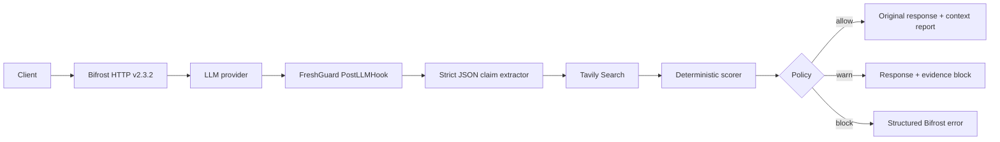

# FreshGuard for Bifrost

FreshGuard is a native [Bifrost](https://github.com/maximhq/bifrost) post-response plugin that detects time-sensitive claims, checks them with Tavily evidence, and applies an `allow`, `warn`, or `block` freshness policy before an AI response reaches the caller.

It targets the Global AI Hackathon problem statement **Open-Source Bifrost Gateway**, with an optional Tavily stale-answer-detector integration.

## Why it matters

AI gateways already control routing, cost, and reliability. FreshGuard adds a missing production control: whether a factual answer is still current. It treats missing evidence as `unverified`, never as false, and never silently upgrades a failed search into a verified result.

## What judges can see

- Atomic time-sensitive claims extracted from a non-streaming chat response.
- At most three Tavily searches per response.
- A deterministic 0–100 score with visible components and citations.
- `allow`: preserve the provider response and attach a report to Bifrost context.
- `warn`: append a compact freshness report to the response.
- `block`: return a structured non-fallback Bifrost error when a claim is below threshold.
- Fail-safe `verification_unavailable` behavior for timeout, rate limit, 5xx, network, or malformed Tavily responses.

## Architecture



More detail: [docs/architecture.md](docs/architecture.md).

## Requirements

- Go **1.27.3** for ABI-compatible native plugin builds.
- Bifrost HTTP **v2.3.2** / core **v1.13.1**.
- Docker with Compose for the containerized gateway path.
- `OPENAI_API_KEY`, `EXTRACTOR_API_KEY`, `TAVILY_API_KEY`, and a 32-byte `BIFROST_ENCRYPTION_KEY`.

## Quick start

```sh
cp .env.example .env
# Fill the four required values in .env.
docker compose up --build
```

In another terminal:

```sh
./scripts/demo.sh
```

The demo makes a current-version request and an intentionally stale-version request. The latter should contain a `FreshGuard freshness check` section with status, score, and source URLs.

## Build without Docker

```sh
go build -buildmode=plugin -trimpath -o freshguard.so ./cmd/plugin
```

Native plugins must be compiled with the same Go toolchain and Bifrost core version as the gateway. The repository pins both requirements.

## Test

```sh
go test -race ./...
go vet ./...
```

The integration test builds the native `.so` and loads it in an isolated process to verify the official `Init`, `GetName`, `PreRequestHook`, `PreLLMHook`, `PostLLMHook`, and `Cleanup` exports. The same artifact has also been smoke-tested in the official Bifrost HTTP v2.3.2 binary, where it reported `freshguard - active` and `/health` returned `status: ok`.

## Configuration

`config.example.json` registers `/plugins/freshguard.so` as a `post_builtin` plugin.

| Key | Default | Purpose |
|---|---:|---|
| `enabled` | `false` | Enables verification. |
| `policy` | `warn` | `allow`, `warn`, or `block`. |
| `threshold` | `60` | Minimum acceptable score, 0–100. |
| `max_claims` | `3` | Maximum extracted claims. |
| `max_queries` | `3` | Declared Tavily query budget. The verifier hard-caps at three. |
| `timeout` | `5s` | HTTP timeout for extraction and search. |
| `extractor_endpoint` | OpenAI chat completions | JSON-capable extraction endpoint. |
| `extractor_model` | `gpt-4o-mini` | Extraction model. |

Secrets are read only from environment variables. They are not logged or included in plugin errors.

## Scoring

FreshGuard combines recency (35%), source agreement (30%), entailment (25%), and coverage (10%). All components and the final score are clamped to 0–100. Zero evidence returns `unverified`.

See [docs/evaluation.md](docs/evaluation.md) for verified behavior, current measurement status, and the pre-submission benchmark plan.

The 60-case benchmark is frozen in [`benchmark/cases.jsonl`](benchmark/cases.jsonl). After a real full run, evaluate the observation JSONL with:

```sh
go run ./cmd/benchmark -observations benchmark/observations.jsonl
```

The command refuses incomplete or duplicate runs and prints the confusion matrix plus the required submission metrics. No benchmark result is bundled until the live run has actually been measured.

## Security and privacy

- The plugin sends only extracted claims—not the full conversation—to Tavily.
- API keys stay in environment variables.
- Provider errors are passed through unchanged; FreshGuard never masks them.
- Verification is bounded to three claims and three searches.
- Native Go plugins execute inside the gateway process and should be built from reviewed source.

## Limitations

- The competition slice supports non-streaming chat completions only.
- Claim extraction requires an external JSON-capable model endpoint.
- Tavily relevance score is used as an entailment proxy in the baseline; a dedicated NLI stage is future work.
- The current automated suite proves deterministic behavior and packaging, not production stale-answer accuracy. Dataset results will be added only after measured.

## Disclosure

FreshGuard is an independent hackathon project. It is not an official Maxim/Bifrost or Tavily product. Bifrost and Tavily names identify integration targets only.

## License

Apache-2.0. See [LICENSE](LICENSE).
