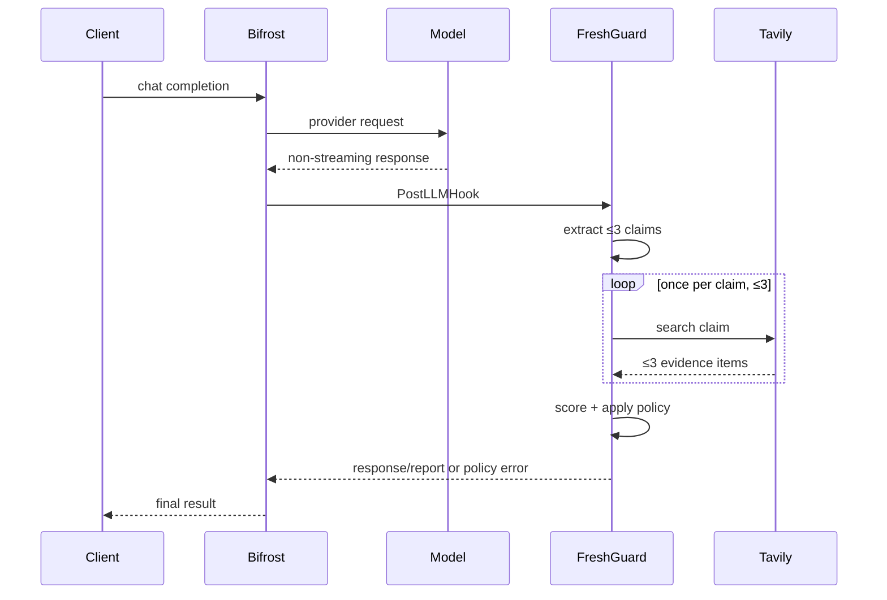

# Architecture

## Request lifecycle

1. Bifrost calls the configured provider normally.
2. `PostLLMHook` exits immediately for disabled verification, provider errors, nil responses, streaming responses, tool-only messages, or empty content.
3. The extractor asks a JSON-capable model for objective, time-sensitive atomic claims in one of seven domains: `pricing`, `api_version`, `regulation`, `company`, `person`, `schedule`, or `other`.
4. FreshGuard normalizes, deduplicates, and caps claims at three.
5. Tavily searches each claim once, returning at most three sources per query.
6. The scorer creates a deterministic `ClaimResult` and aggregate `VerificationReport`.
7. The policy either preserves, annotates, or blocks the response.

## Components

| Component | Responsibility | Failure behavior |
|---|---|---|
| `JSONExtractor` | Strict claim JSON, validation, deduplication, limit | `verification_unavailable`; never invents claims locally |
| `TavilyVerifier` | Evidence search and mapping | Timeout/429/5xx/network/malformed response return `ErrVerificationUnavailable` |
| `Score` | Recency/agreement/entailment/coverage | Empty evidence is `unverified` |
| `Plugin` | Bifrost guards, report aggregation, policy | Existing provider errors pass through unchanged |
| `RenderReport` | Stable judge-visible output | Sorts claims and citations for repeatable demos |

## Concurrency

The request report is allocated per hook call and stored on Bifrost's thread-safe request context. Plugin configuration and clients are immutable after initialization. The dynamic entry point protects singleton initialization and cleanup with a mutex. `go test -race ./...` covers concurrent report creation.

## Trust boundaries

- Model output is untrusted and must match strict JSON and allowed domains.
- Tavily payloads are untrusted and decoded into bounded typed structures.
- Provider errors remain authoritative.
- Secrets are loaded from process environment and omitted from error messages.

## Deliberate scope

The winning slice is a native non-streaming chat plugin. Streaming requires buffering or incremental claim verification and is intentionally excluded so the submission can demonstrate correct gateway behavior rather than an unsafe partial implementation.
